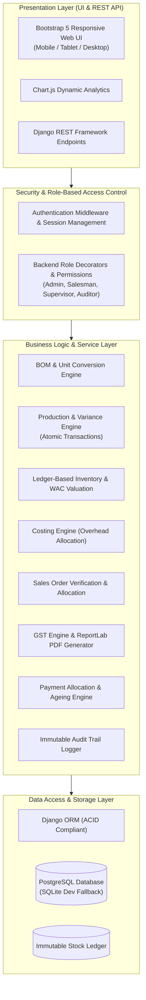
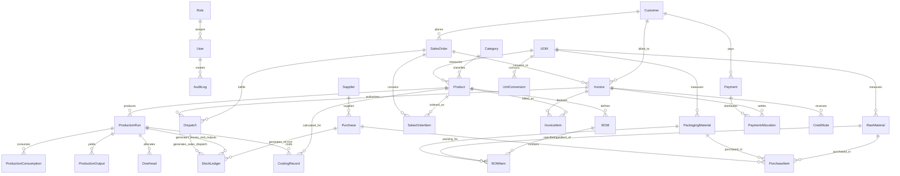

# FactoryFlow – System Architecture & Design Specification
## Integrated Order-to-Audit Management System for Packaged Food Manufacturing
**Centre for Digital Infrastructure, NIT Tiruchirappalli – Technical Design Document**

---

## 1. System Architecture Overview

FactoryFlow is designed using a **layered, service-oriented monolithic architecture** built upon Django 5, PostgreSQL, and Bootstrap 5. It completely decouples business logic from HTTP presentation views by routing all critical operations through an explicit **Service Layer**.

### High-Level Architectural Diagram

---

## 2. Entity-Relationship (ER) Architecture

The database model follows **3rd Normal Form (3NF)** with strict referential integrity, foreign key constraints, unique constraints, and database-level indexing for high-performance querying.

---

## 3. Core Business Logic & Mathematical Formulations

### 3.1 Inventory Accounting & Stock Ledger
Inventory accounting strictly uses an **immutable ledger-based approach**. Balances are never modified directly via manual edits; instead, every movement originates from an authorized source document and creates a signed entry in the `StockLedger`.

#### Closing Stock Equation:
$$\text{Closing Stock} = \text{Opening Stock} + \sum \text{Receipts} - \sum \text{Issues} - \sum \text{Dispatches} + \sum \text{Returns} \pm \sum \text{Adjustments}$$

#### Transaction Types:
- `OPENING_STOCK`: Initial benchmark or audit opening balances.
- `PURCHASE_RECEIPT`: Supplier delivery confirmations.
- `PRODUCTION_ISSUE`: Actual raw material and packaging consumption during batch execution.
- `PRODUCTION_OUTPUT`: Finished goods released into inventory.
- `SALES_DISPATCH`: Finished goods leaving warehouse against verified sales orders/invoices.
- `SALES_RETURN`: Goods received back from customer.
- `STOCK_ADJUSTMENT`: Cycle count reconciliations authorized by Admin.

### 3.2 Weighted Average Cost (WAC) Method
When new raw materials are purchased, the unit valuation is recalculated dynamically across existing on-hand stock and new inward receipts:

$$\text{New WAC} = \frac{(\text{Current Qty} \times \text{Current WAC}) + (\text{Inward Qty} \times \text{Purchase Rate})}{\text{Current Qty} + \text{Inward Qty}}$$

*Benchmark Verification:*
- Opening flour: $100\text{ kg} \times ₹42/\text{kg} = ₹4,200$
- New purchase: $60\text{ kg} \times ₹45/\text{kg} = ₹2,700$
- Total quantity: $100 + 60 = 160\text{ kg}$
- Recalculated WAC: $\frac{₹4,200 + ₹2,700}{160} = \frac{₹6,900}{160} = ₹43.125/\text{kg}$

### 3.3 Bill of Materials (BOM) & Unit Conversion Utility
The BOM is entirely database-driven, supporting batch-size scaling and standard yields. Standard conversions between mass (kg, g), volume (L, ml), and discrete packaging units (pieces, packets, cartons) are processed through a centralized `UnitConverter` utility:
- $1\text{ kg} = 1,000\text{ g}$
- $1\text{ L} = 1,000\text{ ml}$
- Cartons to Packets: Based on product packaging configuration (e.g., 20 packets/carton or configured batch pieces).

### 3.4 Production Variance Engine
During production execution, planned consumption is derived from the BOM formula:
$$\text{Planned Material} = \frac{\text{Standard BOM Quantity}}{\text{BOM Batch Size}} \times \text{Production Batch Quantity}$$

#### Variance Calculations:
$$\text{Consumption Variance \%} = \left(\frac{\text{Actual Consumption} - \text{Planned Consumption}}{\text{Planned Consumption}}\right) \times 100$$

$$\text{Yield Variance \%} = \left(\frac{\text{Actual Good Output} - \text{Expected Output}}{\text{Expected Output}}\right) \times 100$$

- **Alert Condition**: If $|\text{Variance \%}| > 3.0\%$, the system automatically flags a **Variance Alert** with audit logging.
- *Benchmark Verification:*
  - Oil: Planned = $10.0\text{ L}$, Actual = $10.5\text{ L} \implies \left(\frac{10.5 - 10}{10}\right) \times 100 = +5.0\%$ (FLAGGED)
  - Yield: Expected = $200\text{ packets}$, Actual = $188\text{ packets} \implies \left(\frac{188 - 200}{200}\right) \times 100 = -6.0\%$ (FLAGGED)

### 3.5 Costing Engine & Overhead Allocation
Costing is performed per production run using actual consumption and weighted-average rates:
1. **Raw Material Cost**: $\sum (\text{Actual RM Quantity} \times \text{WAC Rate})$
2. **Packaging Cost**: $\sum (\text{Total Pouches Consumed [Good + Damaged]} \times \text{Pouch Rate}) + (\text{Cartons Used} \times \text{Carton Rate})$
3. **Allocated Overheads**: Direct Labour + Gas & Electricity + Other Utilities
4. **Total Production Cost**: $\text{Raw Material Cost} + \text{Packaging Cost} + \text{Labour} + \text{Power/Fuel} + \text{Overheads}$
5. **Cost Per Good Packet**:
   $$\text{Cost Per Packet} = \frac{\text{Total Production Cost}}{\text{Actual Good Packets Produced}}$$
6. **Gross Margin Per Packet**:
   $$\text{Gross Margin} = \text{Selling Price (Excl. Tax)} - \text{Cost Per Packet}$$

*Benchmark Verification:*
- Flour: $40\text{ kg} \times ₹43.125 = ₹1,725.00$
- Oil: $10.5\text{ L} \times ₹140.00 = ₹1,470.00$
- Spices: $1.2\text{ kg} \times ₹200.00 = ₹240.00$
- Pouches: $194\text{ pcs (188 good + 6 damaged)} \times ₹2.50 = ₹485.00$
- Cartons: $9\text{ pcs} \times ₹15.00 = ₹135.00$
- Total Direct Materials: $₹4,055.00$
- Labour: $₹1,200.00$
- Gas & Electricity: $₹600.00$
- Total Production Cost: $₹4,055 + ₹1,200 + ₹600 = ₹5,855.00$
- Good Packets Produced: $188$
- Cost Per Packet: $\frac{₹5,855}{188} = ₹31.1436... \approx ₹31.14$
- Selling Price: $₹50.00$
- Gross Margin Per Packet: $₹50.00 - ₹31.14 = ₹18.86$

### 3.6 Goods & Services Tax (GST) Engine
FactoryFlow dynamically detects customer jurisdiction based on GSTIN and State Code:
- **Intra-State Supply (Tamil Nadu to Tamil Nadu)**:
  $$\text{CGST} = \text{Taxable Value} \times \frac{\text{GST Rate}}{2}, \quad \text{SGST} = \text{Taxable Value} \times \frac{\text{GST Rate}}{2}$$
- **Inter-State Supply (Tamil Nadu to Other States, e.g., Karnataka)**:
  $$\text{IGST} = \text{Taxable Value} \times \text{GST Rate}$$

*Benchmark Verification:*
- Retailer A (Tamil Nadu): $150\text{ packets} \times ₹50 = ₹7,500.00$
- CGST (2.5%): $₹187.50$
- SGST (2.5%): $₹187.50$
- Total Invoice: $₹7,875.00$

### 3.7 Accounts Receivable & Ageing Analysis
Outstanding balance is computed as:
$$\text{Outstanding} = \text{Invoice Grand Total} - \sum \text{Allocated Payments} - \sum \text{Credit Notes}$$
Payments cannot exceed current outstanding balances. Ageing buckets categorize outstanding balances relative to invoice date:
- $0 - 30\text{ days}$ (Current)
- $31 - 60\text{ days}$
- $61 - 90\text{ days}$
- $> 90\text{ days}$ (Overdue)

---

## 4. Security, Audit Trail, & Immutability Guarantees

1. **Role-Based Access Control**:
   - Four discrete roles: `ADMIN`, `SALESMAN`, `PRODUCTION_SUPERVISOR`, `AUDITOR_OWNER`.
   - Backend decorators (`@role_required`) and DRF permission classes enforce authorization at the controller/view level.
2. **Immutable Financial & Production Records**:
   - Posted invoices and completed production runs cannot be deleted or silently modified.
   - Any financial adjustment requires an explicit `CreditNote` document.
3. **Audit Trail**:
   - The `AuditLog` model captures `user`, `action` (`CREATE`, `UPDATE`, `APPROVE`, `POST`, `CANCEL`), `module`, `record_id`, `changes` (JSON delta), IP address, and timestamp.
